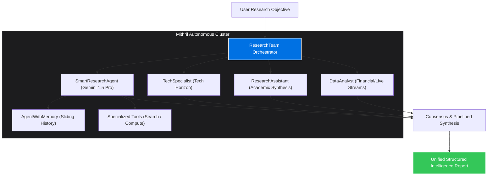

<div align="center">

<!-- Apple-Inspired Ambient Header -->


<!-- Dynamic Live Status Pill Bar -->
<p align="center">
  
  
  
  
</p>

<h3>
  <i>"Deference to content, fluid physics in interaction, and autonomous multi-agent intelligence."</i>
</h3>

<p align="center">
  <a href="https://rahul08319.github.io/Rahul08319/"><b>Explore Interactive Apple-Grade Portfolio Site ↗</b></a> •
  <a href="https://github.com/Rahul08319"><b>GitHub Repositories ↗</b></a> •
  <a href="#-mithril-multi-agent-system"><b>Mithril Architecture ↗</b></a>
</p>

---

</div>

##  Executive Summary & Craft

I specialize in **Autonomous Multi-Agent AI Systems**, **Speculative Tool Routing**, and **Apple-Grade Fluid User Experiences**. My work combines deep algorithmic backends (multi-agent coordination, streaming LLM pipelines, real-time market telemetry) with meticulously crafted interfaces governed by Apple's Human Interface Guidelines — clarity, deference, and depth.

```
┌────────────────────────────────────────────────────────────────────────┐
│                        RAHUL KUMAR SYSTEM CORE                         │
├──────────────────────────┬─────────────────────────────────────────────┤
│ 🧠 Cognitive Frameworks  │ Gemini 1.5/Pro, Mithril Agent, TypeSafe     │
│ ⚡ Systems & Backend     │ Python 3.11+, AsyncIO, PyTest, Node/Bun     │
│ 🎨 Human Interfaces      │ Liquid Glass, SF Pro, CSS Springs, Next.js  │
│ 📡 Real-Time Telemetry   │ Financial Market Streaming, Event Buses     │
└──────────────────────────┴─────────────────────────────────────────────┘
```

---

## 🍱 Bento Architecture Grid

<table>
  <tr>
    <td width="50%" valign="top">
      <h3>🤖 01. Autonomous Multi-Agent Systems</h3>
      <p>Architecting multi-agent teams where specialized cognitive nodes (<b>ResearchAgent</b>, <b>DataAnalyst</b>, <b>TechSpecialist</b>, and <b>SmartResearchAgent</b>) collaborate asynchronously via pipelined message passing and deterministic state consensus.</p>
      <ul>
        <li><b>Dynamic Routing:</b> Pipelined task decomposition & delegation</li>
        <li><b>Cognitive Memory:</b> Context-aware sliding conversation history</li>
        <li><b>LLM Synthesis:</b> Integrated with Gemini APIs for deep reasoning</li>
      </ul>
    </td>
    <td width="50%" valign="top">
      <h3> 02. Liquid Glass & Apple Design Craft</h3>
      <p>Translating Apple Cupertino standards into web and software interfaces. Implementing 2025 Liquid Glass translucency, continuous-corner squircles, and physics-based spring curves.</p>
      <ul>
        <li><b>Restraint First:</b> Content leads; chrome recedes translucently</li>
        <li><b>Realistic Motion:</b> Damped spring physics, zero canned easings</li>
        <li><b>Zero-Gap Bento Grids:</b> Dense, purposeful typography & layout</li>
      </ul>
    </td>
  </tr>
  <tr>
    <td width="50%" valign="top">
      <h3>⚡ 03. High-Throughput Data & Automation</h3>
      <p>Continuous telemetry engines capable of ingesting financial tickers, detecting significant volatility shifts, and dispatching multi-channel alerts.</p>
      <ul>
        <li><b>Event-Driven:</b> Python <code>asyncio</code> task pools</li>
        <li><b>Self-Updating Logic:</b> GitHub Actions & cron-scheduled jobs</li>
        <li><b>Resilience:</b> Graceful degradation and fallback pipelines</li>
      </ul>
    </td>
    <td width="50%" valign="top">
      <h3>🔬 04. System One Models & TypeSafe AI</h3>
      <p>Building with small, calibrated units of AI intelligence used like programming primitives (Choice, Noul, Score) for classification, extraction, and verification.</p>
      <ul>
        <li><b>Calibrated Probability:</b> Distribution-based decision gating</li>
        <li><b>High Compaction:</b> Structured state without verbose tokens</li>
        <li><b>Deterministic Hooks:</b> Combining semantic intelligence & code</li>
      </ul>
    </td>
  </tr>
</table>

---

## 🛠️ Technology Ecosystem

<div align="center">

### Intelligence & Machine Learning
<p>
  
  
  
  
  
  
</p>

### Frontend Engineering & Apple Design
<p>
  
  
  
  
  
  
</p>

### Systems & Cloud Infrastructure
<p>
  
  
  
  
</p>

</div>

---

## 🚀 Featured Architecture: Mithril Multi-Agent System

This repository hosts [`mithril_agent.py`](./mithril_agent.py), an extensible multi-agent research pipeline coordinating specialized workers:



---

## 📈 Real-Time GitHub Telemetry

<div align="center">


<br/>


</div>

---

## 🔄 Self-Updating Perpetual Logic

> [!NOTE]
> This profile is powered by an automated GitHub Action workflow ([`auto-update-profile.yml`](./.github/workflows/auto-update-profile.yml)). Every scheduled interval and each New Year, it automatically:
> - Calculates dynamic years of experience (`Current Year - 2020`).
> - Refreshes stats, commit charts, and release versions.
> - Keeps dates and copyright synchronised for all upcoming years automatically.

---

<div align="center">
  <sub>Designed with precision & craft • Inspired by Apple Human Interface Guidelines • © <span id="year">2026</span> Rahul Kumar</sub>
</div>
